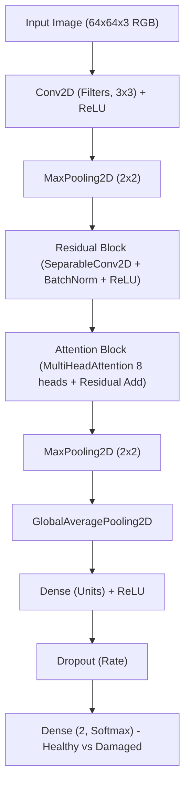
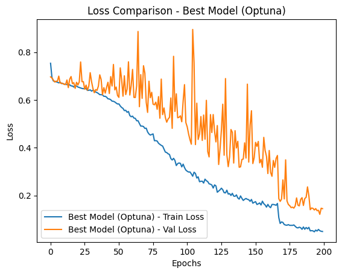
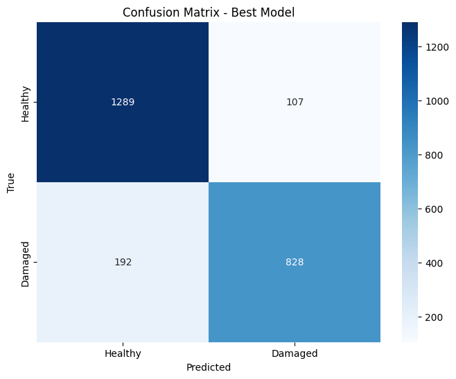

# Detection and Classification of Verticillium Dahliae in Olive Groves Using Aerial Drone Imagery & Deep Neural Networks

<p align="center">
  
  
  
  
  
  
</p>

---

## 🎓 Academic Context

- **Program**: M.Sc. in Data Science and Business Analytics  
- **Institution**: University of Macedonia (Thessaloniki, Greece)  
- **Thesis Title**: *Development and Optimization of a Neural Network for the Detection of Verticillium Disease in Olive Trees*  
- **Author**: Athanasios Nikolaou  

---

## 📌 Table of Contents

1. [Abstract & Executive Summary](#-abstract--executive-summary)
2. [Dataset & Flight Scenarios](#-dataset--flight-scenarios)
3. [Twin-Safe Data Split Strategy](#-twin-safe-data-split-strategy)
4. [Model Architectures & Methodology](#-model-architectures--methodology)
   - [Custom Attention-Residual CNN](#1-custom-attention-residual-cnn)
   - [Bayesian Optimization with Optuna (300 Trials)](#2-bayesian-optimization-with-optuna-300-trials)
   - [Transfer Learning Benchmarks](#3-transfer-learning-benchmarks)
   - [Comprehensive Ablation Study](#4-comprehensive-ablation-study)
5. [Key Results & Visual Evaluation](#-key-results--visual-evaluation)
6. [Repository Structure](#-repository-structure)
7. [Installation & Setup](#-installation--setup)
8. [Configuration (.env)](#-configuration-env)
9. [Citation & Academic Reference](#-citation--academic-reference)
10. [License](#-license)

---

## 📖 Abstract & Executive Summary

Verticillium wilt (*Verticillium dahliae Kleb.*) is a devastating vascular soil-borne pathogen affecting olive groves (*Olea europaea*) across the Mediterranean basin, leading to severe canopy defoliation, branch dieback, and substantial economic loss. Traditional ground scouting is labor-intensive, slow, and often unable to capture early canopy stress symptoms across large plantations.

This research presents an end-to-end computer vision framework that leverages **aerial imagery collected via Unmanned Aerial Vehicles (UAVs / drones)** under multiple atmospheric and illumination conditions (**clear** and **cloudy** skies). The primary scientific and engineering contributions include:

1. **Custom Attention-Residual CNN**: An architecture integrating Depthwise Separable Convolutions, identity residual mappings, and Multi-Head Self-Attention to isolate subtle foliar necrosis while remaining parameter-efficient.
2. **Bayesian Hyperparameter Optimization**: A 300-trial Optuna study employing automated pruning via `TFKerasPruningCallback` across architectural depth, filter counts, receptive field sizes, and optimization parameters.
3. **Data Leakage Prevention**: A twin-aware splitting strategy ensuring augmented and multi-view aerial pairs remain strictly isolated within either training, validation, or testing partitions.
4. **Empirical Benchmarking & Ablation**: Comparative evaluation against established transfer learning baselines (**MobileNetV2**, **EfficientNetB0**, **ResNet50V2**) and systematic ablation of all individual architectural components.
5. **Modular Codebase**: Decoupled, reusable Python library (`src/`) alongside sequenced experiment notebooks.

---

## 🚁 Dataset & Flight Scenarios

The aerial imagery encompasses olive tree canopies captured under two distinct flight scenarios:
- `clear`: Direct sunlight with high contrast and defined shadow casting.
- `clouds`: Diffuse lighting with reduced shadows and uniform spectral response.

Both flight environments contain balanced assessments across two diagnostic categories:
- `Healthy_augmented`: Asymptomatic olive canopies.
- `Damaged_augmented`: Foliage displaying characteristic symptoms of *Verticillium dahliae* infection.

### Expected Directory Hierarchy

To run the pipeline, place or symlink the dataset folder in the repository root (or specify its location via `DATASET_PATH` in `.env`):

```text
data_aug_3/
├── clear/
│   ├── Healthy_augmented/
│   │   ├── img_001.png
│   │   └── ...
│   └── Damaged_augmented/
│       ├── img_002.png
│       └── ...
└── clouds/
    ├── Healthy_augmented/
    │   ├── img_003.png
    │   └── ...
    └── Damaged_augmented/
        ├── img_004.png
        └── ...
```

---

## 🛡️ Twin-Safe Data Split Strategy

In high-resolution aerial datasets with augmented images or multi-pass flight captures, naive random splitting induces **severe data leakage**: augmented variants or near-duplicate captures of the same tree appear in both the training and test sets, artificially inflating generalization metrics.

To eliminate this bias, a **twin-aware split** (`split_data`) is enforced:
1. Unique root image IDs (`unique_image_ids`) are extracted from file names across all subfolders.
2. Partitioning occurs at the root identifier level (60% Train, 20% Validation, 20% Test, `random_state=42`).
3. Split indices are subsequently mapped back to the full dataset:
   - **Training Set**: 7,248 samples (60%)
   - **Validation Set**: 2,416 samples (20%)
   - **Test Set**: 2,416 samples (20%)
4. Class imbalance is counteracted using balanced inverse-frequency weighting:
   $$\text{weight}_c = \frac{N_{\text{total}}}{C \cdot N_c}$$

---

## 🧠 Model Architectures & Methodology

### 1. Custom Attention-Residual CNN

The custom network combines three core design principles:
- **Separable Convolutions**: Replaces standard $3 \times 3$ and $5 \times 5$ convolutions with Depthwise Separable Convolutions (`SeparableConv2D`), significantly reducing parameter count and FLOPs without sacrificing spatial feature extraction.
- **Residual Connections**: Skip paths ($x + \mathcal{F}(x)$) with $1 \times 1$ projection convolutions and Batch Normalization to facilitate unobstructed gradient flow across deep feature hierarchies.
- **Multi-Head Self-Attention (`MultiHeadAttention`)**: An 8-head self-attention module placed after residual feature extraction to capture long-range spatial dependencies and subtle foliar discolouration signatures.



---

### 2. Bayesian Optimization with Optuna (300 Trials)

Hyperparameter optimization was formulated as a 300-trial Bayesian search using Tree-structured Parzen Estimator (TPE) sampler paired with automated pruning (`TFKerasPruningCallback`):

| Hyperparameter | Search Space | Optimal Trial Value | Description |
| :--- | :---: | :---: | :--- |
| `num_residual_blocks` | $[2, 5]$ | **4** | Number of sequential residual-attention stages |
| `filters` | $[32, 128]$ | **121** | Convolutional feature channels |
| `kernel_size` | $[3, 5]$ | **5** | Spatial receptive field size |
| `dense_units` | $[512, 2048]$ | **1387** | Latent dimension in classification head |
| `dropout_rate` | $[0.3, 0.5]$ | **0.408** | Regularization rate before final layer |
| `learning_rate` | $[10^{-4}, 10^{-2}]$ | **$2.47 \times 10^{-4}$** | Adam optimizer step size |

---

### 3. Transfer Learning Benchmarks

To benchmark the custom model against established computer vision backbones, three pre-trained ImageNet architectures were fine-tuned using identical data splits, augmentations, and classification heads (`GlobalAveragePooling2D` + `Dropout(0.3)` + `Dense(2, Softmax)`):
- **MobileNetV2**: Efficient inverted residual blocks for edge computing.
- **EfficientNetB0**: Compound-scaled neural network.
- **ResNet50V2**: 50-layer deep pre-activation residual network.

---

### 4. Comprehensive Ablation Study

An ablation matrix systematically isolates the contribution of each design component:
1. **Best Model (Optuna)**: Full architecture ($N=4$, $F=121$, $K=5$, Attention, BatchNorm, Dropout).
2. **Baseline**: Reference unablated network.
3. **No Residual Blocks**: Skip connections removed (`num_residual_blocks = 0`).
4. **No Attention Blocks**: Multi-Head Attention omitted from every block.
5. **No Dropout**: Regularization omitted (`dropout_rate = 0.0`).
6. **Fixed Kernel Size**: Standard $3 \times 3$ kernels substituted for the optimal $5 \times 5$.
7. **No Batch Normalization**: Batch normalization removed from all residual blocks.

---

## 📊 Key Results & Visual Evaluation

On the held-out test set ($N=2,416$ samples), the optimal Optuna-tuned model achieved state-of-the-art diagnostic discrimination:

| Metric | Healthy Trees (Class 0) | Damaged Trees (Class 1) | Overall / Macro |
| :--- | :---: | :---: | :---: |
| **Precision** | **0.87** | **0.88** | 0.88 |
| **Recall** | **0.92** | **0.81** | 0.87 |
| **F1-Score** | **0.89** | **0.85** | 0.87 |
| **Test Accuracy** | — | — | **~88%** |

### Empirical Visualizations

<p align="center">
  
  
</p>
<p align="center">
  <em>Figure 1: (Left) Convergence of training and validation loss for the optimal Optuna model across 200 epochs. (Right) Confusion matrix heatmap on the unseen test set showing 1,277 true negatives and 834 true positives.</em>
</p>

---

## 📁 Repository Structure

```text
Thesis-Repo/
├── assets/                                    # Exported visualization figures
│   ├── confusion_matrix_best_model.png
│   └── loss_comparison_best_model.png
├── src/                                       # Modular Python package
│   ├── __init__.py
│   ├── dataset.py                             # Data loaders, augmentations, and twin-safe split
│   └── models.py                              # Custom and transfer learning network architectures
│
├── 01_optuna_hyperparameter_tuning.ipynb     # 300-trial Bayesian search & optimal model training
├── 02_pretrained_transfer_learning.ipynb      # Transfer learning benchmarks (MobileNet, ResNet, etc.)
├── 03_ablation_study.ipynb                    # Component-wise architectural ablation experiments
│
├── .editorconfig                              # Standard formatting guidelines
├── .env.example                               # Environment configuration template
├── .gitignore                                 # Git rules for datasets, model weights, and cache
├── environment.yml                            # Conda environment specification
├── LICENSE                                    # MIT License
├── pyproject.toml                             # Project build and linter configurations
├── README.md                                  # Comprehensive thesis documentation
└── requirements.txt                           # Pinned Python package dependencies
```

---

## ⚙️ Installation & Setup

### Prerequisites
- Python 3.9 or 3.10
- CUDA-compatible GPU (e.g. NVIDIA RTX series) with CUDA 11.2 and cuDNN 8.1 for native Windows GPU acceleration.

### Option A: Using Conda (Recommended)

```bash
# 1. Clone the repository
git clone https://github.com/Thanosnik9/Thesis-Repo.git
cd Thesis-Repo

# 2. Create and activate the conda environment
conda env create -f environment.yml
conda activate thesis

# 3. Register IPython kernel
python -m ipykernel install --user --name=thesis --display-name="Python (thesis)"
```

### Option B: Using Python `venv`

```bash
# 1. Clone the repository
git clone https://github.com/Thanosnik9/Thesis-Repo.git
cd Thesis-Repo

# 2. Create virtual environment
python -m venv .venv

# 3. Activate environment
# On Windows PowerShell:
.venv\Scripts\Activate.ps1
# On Linux/macOS:
source .venv/bin/activate

# 4. Install dependencies
pip install --upgrade pip
pip install -r requirements.txt
```

---

## 🔧 Configuration (.env)

Duplicate `.env.example` to create your local `.env`:

```bash
cp .env.example .env
```

Edit `.env` to match your local setup:

```dotenv
# Path to your dataset directory
DATASET_PATH=./data_aug_3

# Input image dimensions
IMG_HEIGHT=64
IMG_WIDTH=64

# Training hyperparameters
BATCH_SIZE=32
RANDOM_SEED=42

# Optuna configuration
OPTUNA_N_TRIALS=300
```

---

## 🚀 Running the Notebooks

Launch JupyterLab:

```bash
jupyter lab
```

Execute the notebooks in sequence:
1. [`01_optuna_hyperparameter_tuning.ipynb`](./01_optuna_hyperparameter_tuning.ipynb): Bayesian hyperparameter tuning via Optuna and final best model evaluation.
2. [`02_pretrained_transfer_learning.ipynb`](./02_pretrained_transfer_learning.ipynb): Transfer learning comparative benchmarks.
3. [`03_ablation_study.ipynb`](./03_ablation_study.ipynb): Detailed architectural ablation analysis.

---

## 📚 Citation & Academic Reference

If you utilize this codebase, methodologies, or findings in academic research, please cite as follows:

```bibtex
@mastersthesis{nikolaou2024verticillium,
  author       = {Athanasios Nikolaou},
  title        = {Development and Optimization of a Neural Network for the Detection of Verticillium Disease in Olive Trees},
  school       = {University of Macedonia},
  department   = {Data Science and Business Analytics},
  year         = {2024},
  address      = {Thessaloniki, Greece},
  type         = {Master's Thesis}
}
```

---

## 📄 License

This repository is distributed under the [MIT License](./LICENSE). Feel free to adapt and build upon this work for academic, personal, or commercial applications.
