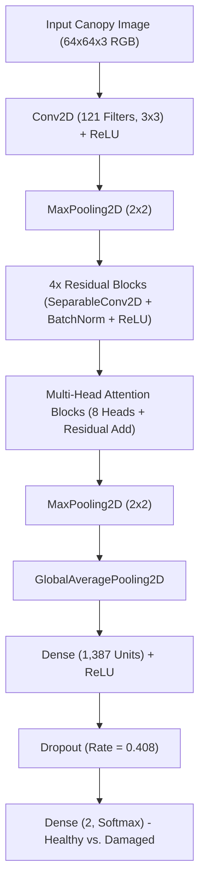
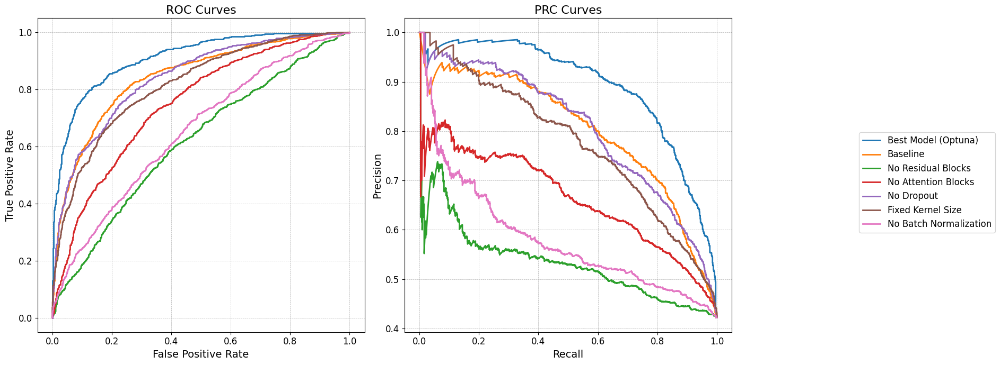

# Development and Optimization of a Neural Network for the Detection of Verticillium Disease in Olive Trees

<p align="center">
  <a href="http://dspace.lib.uom.gr/handle/2159/33690">
    
  </a>
  <a href="https://dspace.lib.uom.gr/bitstream/2159/33690/1/NikolaouAthanasiosMsc2025.pdf">
    
  </a>
  <a href="https://www.uom.gr/mbads">
    
  </a>
  
  
  
  
</p>

---

## 🎓 Academic Information & Thesis Metadata

- **Author**: Athanasios Nikolaou ([Νικολάου, Αθανάσιος](http://dspace.lib.uom.gr/browse?type=author&value=%CE%9D%CE%B9%CE%BA%CE%BF%CE%BB%CE%AC%CE%BF%CF%85%2C+%CE%91%CE%B8%CE%B1%CE%BD%CE%AC%CF%83%CE%B9%CE%BF%CF%82))
- **Supervisor**: Prof. Evangelos Kalampokis ([Καλαμπόκης, Ευάγγελος](https://www.uom.gr/ekal))
- **Program**: M.Sc. in Business Analytics and Data Science ([ΠΜΣ Αναλυτική των Επιχειρήσεων και Επιστήμη των Δεδομένων](https://www.uom.gr/mbads))
- **Institution**: University of Macedonia (Thessaloniki, Greece)  
- **Year of Publication**: 2025  
- **Permanent Repository Handle**: [http://dspace.lib.uom.gr/handle/2159/33690](http://dspace.lib.uom.gr/handle/2159/33690)  
- **Full Text (PDF)**: [NikolaouAthanasiosMsc2025.pdf](https://dspace.lib.uom.gr/bitstream/2159/33690/1/NikolaouAthanasiosMsc2025.pdf)

---

## 📌 Table of Contents

1. [Abstract](#-abstract)
2. [Dataset & Flight Scenarios](#-dataset--flight-scenarios)
3. [Twin-Safe Data Split Strategy](#-twin-safe-data-split-strategy)
4. [Custom-Optimized Model Architecture](#-custom-optimized-model-architecture)
   - [Architectural Innovations](#1-architectural-innovations)
   - [Bayesian Hyperparameter Tuning (Optuna 300 Trials)](#2-bayesian-hyperparameter-tuning-optuna-300-trials)
5. [Comparative Benchmark: Custom vs. Pre-Trained Models](#-comparative-benchmark-custom-vs-pre-trained-models)
6. [Ablation Study Analysis & Diagnostic Curves](#-ablation-study-analysis--diagnostic-curves)
7. [Repository Structure](#-repository-structure)
8. [Installation & Setup](#-installation--setup)
9. [Configuration (.env)](#-configuration-env)
10. [Citation & Academic Reference](#-citation--academic-reference)
11. [License](#-license)

---

## 📖 Abstract

> *"This study focuses on detecting Verticillium wilt disease in olive trees using artificial intelligence and deep learning. The aim is to develop and evaluate a customised neural network that can detect the disease from images, helping to improve agricultural management and reduce the economic impact of the disease on the agricultural sector. The methodology includes the collection, pre-processing and enhancement of images related to the disease. A balanced and representative dataset was created using techniques such as data augmentation and normalisation. A custom CNN model was then designed and optimized using the Optuna tool, with a particular focus on structural features such as attention and residual blocks. This was followed by an evaluation through an ablation study, comparison with pre-trained models and visual analysis of performance. The results showed that the proposed model outperforms the baseline and pre-trained architectures in terms of accuracy, achieving high performance on metrics such as precision, recall, and F1-score. Furthermore, the contribution of individual elements of the architecture (such as attention mechanisms) proved to be significant, according to the ablation model analysis. Evaluation with ROC and PRC curves confirmed the stability and generalisation of the model. The findings indicate that the use of targeted deep learning techniques can enhance the early diagnosis of Verticillium wilt and be integrated into agricultural monitoring systems."*
> 
> — **Athanasios Nikolaou, Master's Thesis, University of Macedonia, 2025**

---

## 🚁 Dataset & Flight Scenarios

The aerial drone canopy imagery was collected over olive groves in Chalkidiki, Greece, at fixed flight altitudes under two ambient illumination scenarios:
- `clear`: Direct sunlight with high contrast and defined shadow casting.
- `clouds`: Diffuse lighting with reduced shadows and uniform spectral response.

Both flight environments contain balanced assessments across two diagnostic categories:
- `Healthy_augmented`: Asymptomatic olive tree canopies.
- `Damaged_augmented`: Foliage displaying characteristic symptoms of *Verticillium dahliae* infection.

### Expected Directory Hierarchy

To run the pipeline, place or symlink the dataset folder in the repository root (or specify its location via `DATASET_PATH` in `.env`):

```text
data_aug_3/
├── clear/
│   ├── Healthy_augmented/
│   │   ├── img_001.png
│   │   └── ...
│   └── Damaged_augmented/
│       ├── img_002.png
│       └── ...
└── clouds/
    ├── Healthy_augmented/
    │   ├── img_003.png
    │   └── ...
    └── Damaged_augmented/
        ├── img_004.png
        └── ...
```

---

## 🛡️ Twin-Safe Data Split Strategy

In high-resolution aerial datasets with augmented images or multi-pass flight captures, naive random splitting causes **severe data leakage**: augmented variants or paired flight captures of the same tree appear in both training and test partitions, artificially inflating metrics.

To eliminate this bias, a **twin-aware split** (`split_data`) is strictly enforced:
1. Unique root image IDs (`unique_image_ids`) are extracted from file names across all subfolders.
2. Partitioning occurs at the root tree identifier level (60% Train, 20% Validation, 20% Test, `random_state=42`).
3. Split indices are subsequently mapped back to the full dataset:
   - **Training Set**: 7,248 samples (60%)
   - **Validation Set**: 2,416 samples (20%)
   - **Test Set**: 2,416 samples (20%)
4. Class imbalance is counteracted using balanced inverse-frequency weighting:
   $$\text{weight}_c = \frac{N_{\text{total}}}{C \cdot N_c}$$

---

## 🧠 Custom-Optimized Model Architecture

### 1. Architectural Innovations

The centerpiece of this research is a purpose-built **Attention-Residual Convolutional Neural Network** designed to capture subtle foliar necrosis while maintaining high computational efficiency for agricultural edge deployment:

- **Depthwise Separable Convolutions (`SeparableConv2D`)**: Decomposes spatial convolution into depthwise and pointwise stages, radically reducing parameter overhead while preserving spatial representational capacity.
- **Identity Residual Connections**: Skip paths ($x + \mathcal{F}(x)$) augmented with $1 \times 1$ projection convolutions and Batch Normalization to prevent vanishing gradients across deep stages.
- **Multi-Head Self-Attention (`MultiHeadAttention`)**: An 8-head self-attention mechanism integrated after residual blocks to capture long-range contextual dependencies and distinguish localized canopy discoloration from ambient soil/weed background noise.
- **Global Average Pooling**: Replaces parameter-heavy flattening layers, drastically mitigating overfitting.



---

### 2. Bayesian Hyperparameter Tuning (Optuna 300 Trials)

The architecture was optimized through a rigorous **300-trial Bayesian search** using Tree-structured Parzen Estimator (TPE) sampler paired with automated pruning (`TFKerasPruningCallback`):

| Hyperparameter | Search Space | Optimal Trial Value | Architectural Function |
| :--- | :---: | :---: | :--- |
| `num_residual_blocks` | $[2, 5]$ | **4** | Number of sequential residual-attention stages |
| `filters` | $[32, 128]$ | **121** | Feature channels per convolution layer |
| `kernel_size` | $[3, 5]$ | **5** | Spatial receptive field size |
| `dense_units` | $[512, 2048]$ | **1387** | Latent dimension in classification head |
| `dropout_rate` | $[0.3, 0.5]$ | **0.408** | Regularization rate before final layer |
| `learning_rate` | $[10^{-4}, 10^{-2}]$ | **$2.47 \times 10^{-4}$** | Adam optimizer step size |

---

## 🏆 Comparative Benchmark: Custom vs. Pre-Trained Models

The custom-designed model was directly compared against prominent transfer learning backbones (MobileNetV2, EfficientNetB0, and ResNet50V2) trained under identical data splits, augmentations, and evaluation criteria (**Thesis Table 1, p. 51**):

| Model Architecture | Test Accuracy | Precision (Healthy) | Recall (Healthy) | Precision (Damaged) | Recall (Damaged) | F1-Score (Healthy) | F1-Score (Damaged) |
| :--- | :---: | :---: | :---: | :---: | :---: | :---: | :---: |
| **Custom-Optimized Model (Proposed)** | **0.89** | **0.88** | **0.94** | **0.90** | **0.82** | **0.91** | **0.86** |
| ResNet50V2 | 0.59 | 0.65 | 0.59 | 0.53 | 0.59 | 0.62 | 0.56 |
| EfficientNetB0 | 0.56 | 0.56 | 1.00 | 0.00 | 0.00 | 0.72 | 0.00 |
| MobileNetV2 | 0.53 | 0.64 | 0.37 | 0.48 | 0.74 | 0.47 | 0.58 |

> 💡 **Core Finding**: The custom Attention-Residual CNN outperforms standard ImageNet pre-trained architectures by **+30% overall accuracy**. Generic pre-trained models struggled with the specialized high-frequency spatial patterns of aerial tree canopies (e.g. EfficientNetB0 collapsed to predicting only the majority class), whereas the custom model achieved balanced, robust sensitivity on both healthy and infected trees.

---

## 🔬 Ablation Study Analysis & Diagnostic Curves

To empirically validate each architectural decision, a systematic ablation study was conducted over 200 epochs per variant (**Thesis Table 2, p. 58**):

| Model Variant | Test Accuracy | Test F1-Score | Test AUROC | Test AUPRC | Impact of Component Removal |
| :--- | :---: | :---: | :---: | :---: | :--- |
| **Custom-Optimized Model (Full)** | **0.891** | **0.875** | **0.912** | **0.891** | **Optimal complete architecture** |
| Baseline (Default Parameters) | 0.776 | 0.776 | 0.853 | 0.824 | Unoptimized hyperparameters |
| No Dropout | 0.758 | 0.756 | 0.789 | 0.771 | Reduced regularization; overfitting tendency |
| Fixed Kernel Size ($3 \times 3$) | 0.735 | 0.730 | 0.780 | 0.756 | Rigid receptive field limits multi-scale foliage detection |
| No Attention Blocks | 0.694 | 0.690 | 0.766 | 0.728 | **-20% drop**: Model cannot focus on localized discoloration |
| No Batch Normalization | 0.616 | 0.612 | 0.689 | 0.665 | **-28% drop**: Internal covariate shift destabilizes convergence |
| No Residual Blocks | 0.604 | 0.597 | 0.661 | 0.630 | **-29% drop**: Vanishing gradients impede deep representation learning |

### Receiver Operating Characteristic (ROC) & Precision-Recall (PRC) Curves

<p align="center">
  
</p>
<p align="center">
  <em>Figure 1: Comparison of ROC and PRC curves across all ablation variants (Thesis Figure 26, p. 89). The Custom-Optimized Model (blue curve) consistently dominates across all classification thresholds, verifying high sensitivity and precision under class-imbalanced agricultural surveillance.</em>
</p>

---

## 📁 Repository Structure

```text
Thesis-Repo/
├── assets/                                    # Evaluation visualization figures
│   └── roc_prc_curves_ablation.png            # Figure 26: ROC & PRC curves
├── src/                                       # Modular Python package
│   ├── __init__.py
│   ├── dataset.py                             # Data loaders, augmentations, and twin-safe split
│   └── models.py                              # Custom and transfer learning network architectures
│
├── 01_optuna_hyperparameter_tuning.ipynb     # 300-trial Bayesian search & optimal model training
├── 02_pretrained_transfer_learning.ipynb      # Transfer learning comparative benchmarks
├── 03_ablation_study.ipynb                    # Component-wise architectural ablation experiments
│
├── .editorconfig                              # Standard formatting guidelines
├── .env.example                               # Environment configuration template
├── .gitignore                                 # Git rules for datasets, model weights, and cache
├── environment.yml                            # Conda environment specification
├── LICENSE                                    # MIT License
├── pyproject.toml                             # Project build and tool configurations
├── README.md                                  # Comprehensive thesis documentation
└── requirements.txt                           # Pinned Python package dependencies
```

---

## ⚙️ Installation & Setup

### Prerequisites
- Python 3.9 or 3.10
- CUDA-compatible GPU (e.g. NVIDIA RTX series) with CUDA 11.2 and cuDNN 8.1 for native Windows GPU acceleration.

### Option A: Using Conda (Recommended)

```bash
# 1. Clone the repository
git clone https://github.com/Thanosnik9/Thesis-Repo.git
cd Thesis-Repo

# 2. Create and activate the conda environment
conda env create -f environment.yml
conda activate thesis

# 3. Register IPython kernel
python -m ipykernel install --user --name=thesis --display-name="Python (thesis)"
```

### Option B: Using Python `venv`

```bash
# 1. Clone the repository
git clone https://github.com/Thanosnik9/Thesis-Repo.git
cd Thesis-Repo

# 2. Create virtual environment
python -m venv .venv

# 3. Activate environment
# On Windows PowerShell:
.venv\Scripts\Activate.ps1
# On Linux/macOS:
source .venv/bin/activate

# 4. Install dependencies
pip install --upgrade pip
pip install -r requirements.txt
```

---

## 🔧 Configuration (.env)

Duplicate `.env.example` to create your local `.env`:

```bash
cp .env.example .env
```

Edit `.env` to match your local setup:

```dotenv
# Path to your dataset directory
DATASET_PATH=./data_aug_3

# Input image dimensions
IMG_HEIGHT=64
IMG_WIDTH=64

# Training hyperparameters
BATCH_SIZE=32
RANDOM_SEED=42

# Optuna configuration
OPTUNA_N_TRIALS=300
```

---

## 🚀 Running the Notebooks

Launch JupyterLab:

```bash
jupyter lab
```

Execute the notebooks in sequence:
1. [`01_optuna_hyperparameter_tuning.ipynb`](./01_optuna_hyperparameter_tuning.ipynb): Bayesian hyperparameter tuning via Optuna and final best model evaluation.
2. [`02_pretrained_transfer_learning.ipynb`](./02_pretrained_transfer_learning.ipynb): Transfer learning comparative benchmarks.
3. [`03_ablation_study.ipynb`](./03_ablation_study.ipynb): Detailed architectural ablation analysis.

---

## 📚 Citation & Academic Reference

If you utilize this codebase, methodologies, or findings in academic research, please cite the official thesis:

```bibtex
@mastersthesis{nikolaou2025verticillium,
  author       = {Athanasios Nikolaou},
  title        = {Development and Optimization of a Neural Network for the Detection of Verticillium Disease in Olive Trees},
  school       = {University of Macedonia},
  department   = {M.Sc. in Business Analytics and Data Science},
  year         = {2025},
  month        = {October},
  address      = {Thessaloniki, Greece},
  type         = {Master's Thesis},
  supervisor   = {Evangelos Kalampokis},
  url          = {http://dspace.lib.uom.gr/handle/2159/33690}
}
```

---

## 📄 License

The code in this repository is distributed under the [MIT License](./LICENSE). The accompanying thesis document is openly accessible via the [University of Macedonia Digital Repository (Psepheda)](http://dspace.lib.uom.gr/handle/2159/33690).
